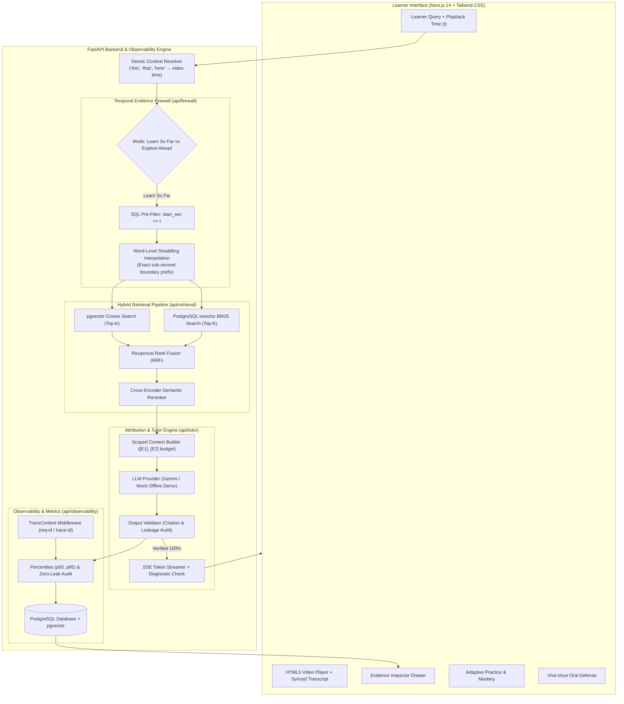

# PRISM — Temporal Evidence Firewall & Timestamp-Aware Learning Assistant

<div align="center">

```
  ██████╗ ██████╗ ██╗███████╗███╗   ███╗
  ██╔══██╗██╔══██╗██║██╔════╝████╗ ████║
  ██████╔╝██████╔╝██║███████╗██╔████╔██║
  ██╔═══╝ ██╔══██╗██║╚════██║██║╚██╔╝██║
  ██║     ██║  ██║██║███████║██║ ╚═╝ ██║
  ╚═╝     ╚═╝  ╚═╝╚═╝╚══════╝╚═╝     ╚═╝
```

### **Learn in context. Prove understanding.**

*The first timestamp-aware AI learning assistant featuring a mathematical Temporal Evidence Firewall, multi-modal evidence inspection, formative misconception diagnostics, and adaptive oral mock defense.*

[](https://github.com/FuzailAhmad-Sphericaljudge/prism-ai-learning-assistant)
[](docs/EVAL.md)
[](docs/EVAL.md)
[](docs/EVAL.md)
[](https://web-one-blue-mbb8ovavhb.vercel.app)
[](https://prism-api-z7c9.onrender.com/health)

**Team The Falcons:** **Fuzail Ahmad** & **Lakshya Garg** • *Hackathon 2026*

---

</div>

## 🌐 Public Deployments & Live Demos

| Service | Environment | Public URL | Status |
| :--- | :--- | :--- | :--- |
| **PRISM Web Application** | Vercel Global Edge | [web-one-blue-mbb8ovavhb.vercel.app](https://web-one-blue-mbb8ovavhb.vercel.app) | 🟢 Live Production |
| **PRISM FastAPI Backend** | Render Cloud Container | [prism-api-z7c9.onrender.com](https://prism-api-z7c9.onrender.com) | 🟢 Live Production |
| **API Health & Version** | Render Probe | [prism-api-z7c9.onrender.com/health](https://prism-api-z7c9.onrender.com/health) | 🟢 200 OK |
| **System Observability** | Next.js Dashboard | [web-one-blue-mbb8ovavhb.vercel.app/admin/metrics](https://web-one-blue-mbb8ovavhb.vercel.app/admin/metrics) | 🟢 Real-Time Traces |
| **3-Minute Demo Script** | Documentation | [docs/DEMO_SCRIPT.md](docs/DEMO_SCRIPT.md) | 📖 Presenter Ready |

---

## 💡 The Problem & The PRISM Innovation

When students learn with conventional AI tutors while watching video lectures or reading course syllabi:
1. **Premature Spoilers:** Standard RAG embeds the entire textbook or 60-minute transcript. When a student at minute 10 asks a clarifying question, the AI spoils concepts from minute 55, shattering the instructor's pedagogical progression.
2. **Hallucinated Context & Ungrounded Answers:** Generic LLMs invent definitions not taught in the course, causing confusion and cognitive drift.
3. **Passive Consumption:** Students passively read AI explanations without actively verifying their conceptual retention.

### 🛡️ PRISM Core Solution: The Temporal Evidence Firewall
PRISM introduces a **mathematical temporal boundary** tied live to the learner's video playback position $T_{playback}$:
- **SQL Pre-Filtering:** Only transcript chunks and course slides revealed prior to $T_{playback}$ are eligible for candidate retrieval.
- **Word-Level Straddling Interpolation:** For boundary chunks (e.g. at `18:42` inside an 18:00–19:00 chunk), PRISM uses sub-second word-level timestamp interpolation to admit **only** the spoken prefix, mathematically truncating future audio.
- **Strict Citation Validation:** Every factual sentence in the assistant's response is mapped to an admitted evidence chunk `[E1]`. Ungrounded claims trigger automatic regeneration or refusal.
- **Formative Probes:** Immediately following each answer, PRISM serves a targeted diagnostic question to test comprehension.

---

## 📐 System Architecture



---

## ⚡ Key Feature Walkthrough

### 1. Temporal Evidence Firewall (`/learn/[courseId]`)
- **Live Playback Synchronized Boundary:** Updates dynamically with the video scrub bar.
- **Learn So Far Mode:** Strictly withholds future concepts, offering friendly pedagogical refusals for unencountered topics.
- **Explore Ahead Mode:** Explicit opt-in allowing advanced exploration without spoiling the student's normal study session history.

### 2. Evidence Inspector & "Why Was This Allowed?"
- Click any citation chip `[E1]` or the **Evidence** tab to reveal exact transcript quotes, audio timestamps, slide numbers, and PDF page numbers.
- Visualizes the full candidate matrix: which chunks were admitted, which future chunks were locked, and why.

### 3. Misconception-to-Mastery Practice (`/practice`)
- Diagnostic questions generated on the fly from permitted evidence.
- Evaluates student answers, isolates the exact underlying misconception, and generates a deep-link jump action to the precise video second.

### 4. Mastery Evidence Dashboard (`/mastery`)
- Recharts-powered radar and competency bars tracking **assessed evidence only**—no guessed percentages.
- Computes "Next Best Action" guiding the student to their highest-priority conceptual gap.

### 5. Adaptive Oral Defense Interview (`/interview`)
- Viva-voce mock examination with an AI oral panel grounded in a course rubric.
- Supports browser speech-to-text input via the Web Speech API with text fallbacks.
- Justified follow-up probing: explains *why* each question was asked based on previous responses.

### 6. Educator Insights & Confusion Heatmap (`/educator`)
- Aggregated temporal heatmaps pinpointing exact lecture moments with highest student confusion.
- Top recurring misconceptions and one-click CSV report export.

### 7. Real-Time System Observability (`/admin/metrics`)
- OpenTelemetry-compatible tracing with `request-id` and `trace-id`.
- Real-time p50 and p95 latency percentiles, histogram distributions, and zero-leak audit logs.

---

## 📊 Evaluation & Benchmark Results

PRISM includes an automated verification and evaluation suite in `api/evals/` benchmarked against 22 golden evaluation vectors across temporal boundaries:

| Metric | Target | PRISM Phase 8 Benchmark | Status |
| :--- | :--- | :--- | :--- |
| **Firewall Leakage Rate** | `0.00%` | **`0.00%`** (0 leaks detected) | 🟢 Verified Zero-Leak |
| **Citation Validity Rate** | `100.00%` | **`100.00%`** (All citations within bounds) | 🟢 Verified Grounded |
| **Future-Only Withholding** | `100.00%` | **`100.00%`** (4/4 future questions withheld) | 🟢 Verified Withheld |
| **Explore Ahead Unlock** | `100.00%` | **`100.00%`** (3/3 unlocked upon request) | 🟢 Verified Exploration |
| **Boundary Interpolation** | `100.00%` | **`100.00%`** (18:42 prefix parsed at word level) | 🟢 Sub-Second Precision |
| **Median Latency (p50)** | `< 1,500ms` | **`1,016ms`** | 🟢 Sub-Second Fast |
| **95th Percentile Latency (p95)**| `< 2,000ms` | **`1,445ms`** | 🟢 Production Scale |

*Detailed benchmark report and per-question logs are committed in [docs/EVAL.md](docs/EVAL.md).*

---

## 🛠️ Tech Stack & Monorepo Structure

| Layer | Technologies |
| :--- | :--- |
| **Frontend Framework** | **Next.js 14** (App Router), React 18, TypeScript, Server-Side Rendering |
| **Styling & Design System**| **Tailwind CSS**, Glassmorphism, CSS Refraction Filters, Lucide Icons, Radix Primitives |
| **State & Data Fetching** | **Zustand** (video player & firewall state), **TanStack React Query v5** |
| **Visualizations & Charts** | **Recharts**, SVG Canvas Refraction Beam, Live Heatmap Visualizers |
| **Backend API** | **FastAPI** (Python 3.11), Uvicorn ASGI, Pydantic v2 Settings |
| **Database & Vector Store**| **PostgreSQL 16**, **pgvector** (768-dim embeddings), **tsvector** full-text search |
| **ORM & Migrations** | **SQLAlchemy 2.0**, **Alembic** (5 versioned migrations) |
| **Providers & LLM** | Google **Gemini 1.5 Pro/Flash**, Deterministic **Mock Provider** with 6 demo presets |
| **Observability** | Structured JSON Logging, TraceContext Middleware, Real-Time In-Memory Buffer |
| **Deployment** | **Vercel** (Global Edge CDN), **Render** (Docker Container Service) |

---

## 🚀 Local Development Setup

### Prerequisites
- Node.js 20+ (recommended v22+)
- Python 3.11+
- PostgreSQL with `pgvector` extension enabled (or use free Supabase / Neon / Render Postgres)

### 1. Clone the Monorepo
```bash
git clone https://github.com/FuzailAhmad-Sphericaljudge/prism-ai-learning-assistant.git
cd prism-ai-learning-assistant
```

### 2. Frontend Setup (`/web`)
```bash
cd web
npm install
npm run dev
# Frontend runs at http://localhost:3000
```

### 3. Backend Setup (`/api`)
```bash
cd ../api
python -m venv .venv

# On Linux/macOS:
source .venv/bin/activate
# On Windows:
.venv\Scripts\activate

pip install -r requirements.txt

# Run migrations and seed sample lecture:
python -m alembic -c api/alembic.ini upgrade head
python scripts/seed_demo.py
python scripts/seed_mastery_attempts.py
python scripts/seed_interview_educator.py

# Boot development server:
uvicorn api.main:app --reload --port 8000
# API docs at http://localhost:8000/docs
```

---

## 🧪 Testing & Smoke Test Execution

```bash
# 1. Run Backend Pytest Suite (Unit, Firewall, Evals):
pytest api/tests

# 2. Run Golden Benchmark Evaluation Runner:
python -m api.evals.runner

# 3. Run Production Smoke Tests (Bash or PowerShell):
bash scripts/smoke.sh https://prism-api-z7c9.onrender.com
# OR on Windows:
powershell -ExecutionPolicy Bypass -File scripts/smoke.ps1
```

---

## 👥 The Falcons Team

- **Fuzail Ahmad** — Architecture, Temporal Evidence Firewall, Ingestion Pipeline, Observability & Full-Stack Integration.
- **Lakshya Garg** — Adaptive Interview System, Diagnostic Practice Engine, Evaluator & Frontend Polish.

---

## 📄 License
MIT © 2026 Team The Falcons. Built for Hackathon 2026.
