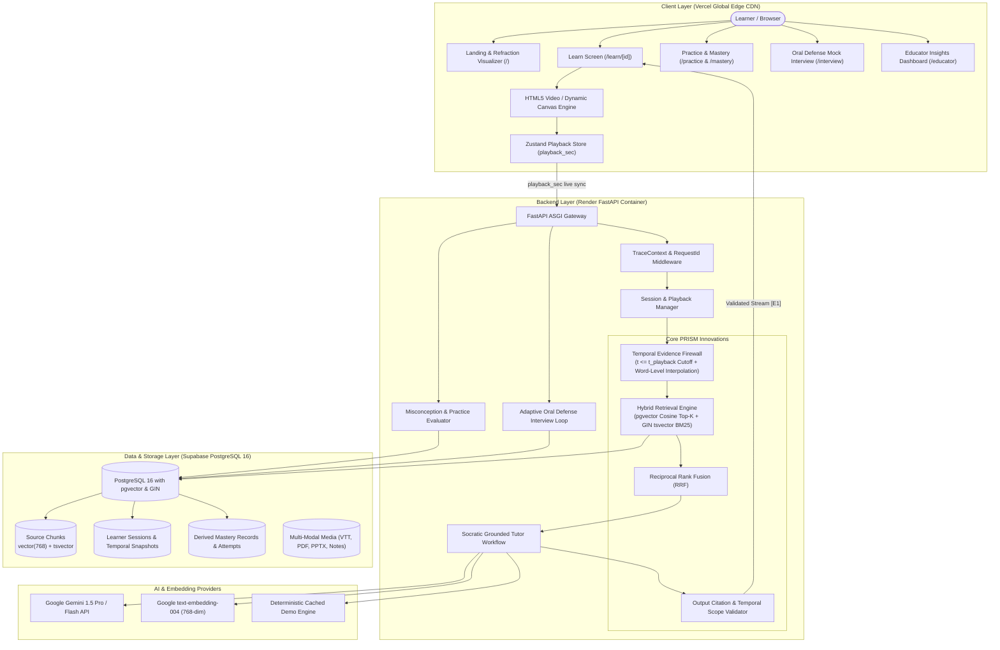

# PRISM System Architecture Specification

> **Team The Falcons | Hackathon 2026**  
> System: **PRISM — Timestamp-Aware AI Learning Assistant with Temporal Evidence Firewall**

---

## 1. High-Level Architecture Diagram

---

## 2. Architectural Pillars

### 1. Temporal Evidence Firewall
- **Invariant:** At video timestamp $t_{\text{playback}}$, an admitted evidence chunk $C$ must satisfy $\max(\text{timestamp}(C)) \le t_{\text{playback}}$.
- **Boundary Straddle Handling:** For chunks straddling $t_{\text{playback}}$ (e.g. at 18:42 for a segment ending at 19:00), sub-second word-level timestamp interpolation reconstructs ONLY the permitted spoken prefix. The future suffix is strictly withheld prior to candidate retrieval.
- **Pedagogical Integrity:** Future concepts (e.g. node deletion, AVL rebalancing) cannot be spoiled or cited while in **Learn So Far** mode.

### 2. Hybrid Retrieval with Reciprocal Rank Fusion (RRF)
- Dense semantic vector search via PostgreSQL `pgvector` (cosine distance top-$K$).
- Sparse lexical search via PostgreSQL `tsvector` with GIN indexing (BM25 keyword top-$K$).
- Candidates are merged via RRF score:
  $$\text{RRF}(d) = \sum_{m \in \{\text{dense}, \text{sparse}\}} \frac{1}{60 + \text{rank}_m(d)}$$

### 3. Pre-Output Citation Validation
- Every generated response must contain inline bracketed citations (e.g. `[E1]`, `[E2]`).
- A deterministic validation layer verifies that every cited chunk ID resides strictly in the admitted candidate set.
- Any forward-referencing claims trigger an automatic one-time regeneration or safe "Not covered yet" redirection.

### 4. Zero-Downtime Multi-Tier Deployment
- **Frontend:** Next.js 14 App Router deployed to Vercel Global Edge CDN with responsive multi-modal panels.
- **Backend:** FastAPI container hosted on Render with health checks, structured tracing, and request-id telemetry.
- **Database:** Supabase PostgreSQL 16 with native `pgvector 0.8.2` and connection pooling.
