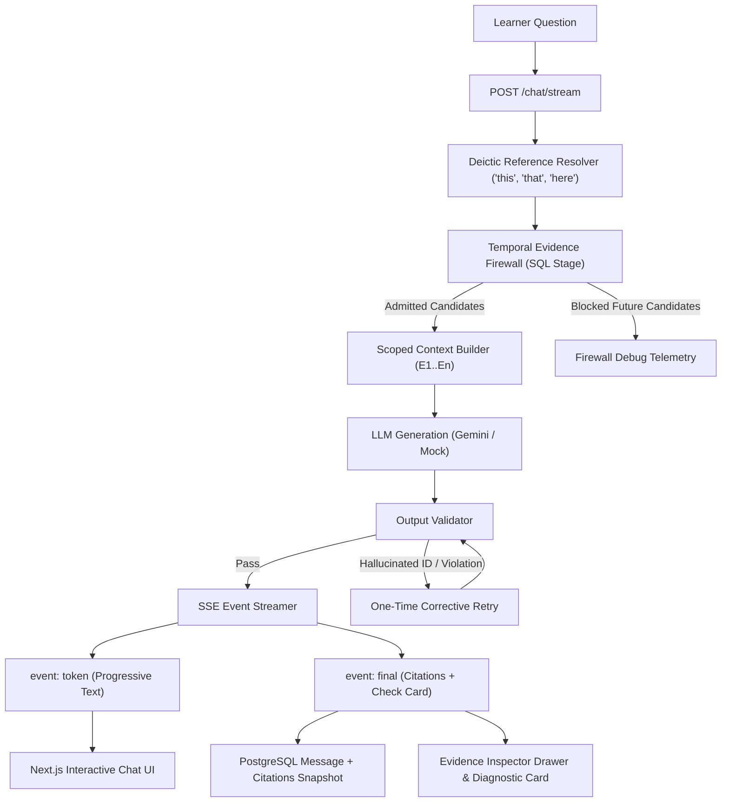

# PRISM Phase 5: Grounded Answers & Evidence Inspector

**Team The Falcons:** Fuzail Ahmad & Lakshya Garg  
**Architecture Specification:** End-to-End Grounded AI Tutor, Output Validation, SSE Streaming, and Multi-Modal Evidence Inspector.

---

## 1. Overview & Core Philosophy

PRISM’s core pedagogical mission is **"Learn in context. Prove understanding."**  
Generic LLM chatbots suffer from two fatal flaws in educational settings:
1. **Curriculum Leakage / Spoilers:** They reveal answers from future lectures, destroying the cognitive challenge of discovering solutions step-by-step.
2. **Hallucinated Citations:** They generate plausible-sounding timestamps or citations that do not exist or do not support the claims made.

Phase 5 delivers the end-to-end realization of Grounded Answers:
- The **Temporal Evidence Firewall** filters knowledge *in the SQL candidate stage* before any text reaches the model.
- The **Output Validator** cryptographically checks every citation ID `[E1..En]` returned by the LLM against the admitted candidate set. Any hallucinated ID triggers a corrective retry.
- **Server-Sent Events (SSE)** deliver real-time token streaming with instant abort capability.
- The **Evidence Inspector** right drawer lets students hover over citations, view exact source quotes, jump to the video timestamp or lecture slide, and inspect the *"Why was this allowed?"* firewall audit panel with animated lock indicators.
- Every explanation is paired with an interactive **Diagnostic Understanding Check** providing instant feedback.

---

## 2. System Architecture



---

## 3. The Output Validator (`api/tutor/validator.py`)

The `OutputValidator` is a pure deterministic engine that audits every model completion before it reaches the user.

### Validation Invariants:
1. **Admitted Set Invariance:** Every inline citation ID `[Ei]` detected in the answer text must belong to the admitted evidence set.
2. **Temporal Scope Invariance:** In `learn_so_far` mode, no citation may point to a chunk whose start timestamp exceeds `playback_sec`.
3. **One-Time Corrective Retry:** If an invalid or ungrounded citation is detected, the workflow prompts the LLM with an explicit corrective constraint (`CORRECTIVE_RETRY_PROMPT`). If it fails a second time, a safe deterministic fallback is returned.
4. **Audit Logging:** Every validation run records:
   - `detected_citation_ids`
   - `admitted_citation_ids`
   - `invalid_citation_ids`
   - `is_valid` status

---

## 4. Server-Sent Events (SSE) Streaming (`POST /chat/stream`)

The streaming endpoint returns standard `text/event-stream` with two event types:

### Progressive Tokens:
```http
event: token
data: {"token": "Binary"}

event: token
data: {"token": " Search"}
```

### Final Structured Payload:
```http
event: final
data: {
  "answer": "Based on the verified lecture materials [E1], the BST property enforces hierarchical ordering.",
  "citations": [
    {
      "evidence_id": "E1",
      "chunk_id": "00000000-0000-0000-0000-000000000101",
      "source_type": "video",
      "coordinate": "02:15 - 03:45",
      "quote": "All keys in the left subtree must be less than the root key.",
      "start_sec": 135.0,
      "end_sec": 225.0
    }
  ],
  "check": {
    "question": "What is the primary condition enforced by a BST?",
    "options": [
      "Left descendants < root <= right descendants",
      "All nodes have identical depth",
      "Nodes are stored in linear array indexes",
      "Trees must be self-balancing at insertion"
    ],
    "correct_index": 0,
    "explanation": "The BST property requires all keys in the left subtree to be strictly less than the root key."
  },
  "is_not_covered": false,
  "validation_passed": true
}
```

---

## 5. Frontend Interactive Components

### 1. `CitationChip` (`web/components/chat/citation-chip.tsx`)
- Monospace font styling with a subtle prism border glow.
- Displays `[E1]` along with the source coordinate (e.g., `05:15` or `Slide 4`).
- Rich hover preview tooltip showing the exact quote, source type icon, and *"Admitted by Temporal Firewall"* badge.
- Clicking the chip triggers the `EvidenceInspectorDrawer`.

### 2. `EvidenceInspectorDrawer` (`web/components/evidence/evidence-inspector-drawer.tsx`)
- Slide-over inspection drawer on the right side of the learning interface.
- Displays the exact quoted text in an emphasized serif reading container.
- Includes a primary **"Jump to moment"** CTA button:
  - Seeks HTML5 video player to the exact second.
  - Jumps slide viewer to the target slide number.
  - Jumps PDF viewer to the cited page.

### 3. `WhyAllowedPanel` (`web/components/evidence/why-allowed-panel.tsx`)
- Visualizes the firewall decision engine for the query.
- Displays admitted chunks (green shield) with status (e.g. `fully_admitted` or `interpolated_straddling`).
- Displays blocked chunks (red pulsing lock) with explicit causal explanations:  
  *`"Blocked by Temporal Evidence Firewall: chunk starts at 18:42, which exceeds session playback position 11:40"`*

### 4. `DiagnosticCheckCard` (`web/components/chat/diagnostic-check-card.tsx`)
- Interactive multiple-choice card rendered beneath every explanation.
- Immediate visual feedback on selection:
  - Correct answer: emerald glow, checkmark icon, and reinforcement explanation.
  - Incorrect answer: rose highlight, shows correct option, and diagnostic misconception explanation.
  - Retry button allows re-attempting the check.

### 5. `NotCoveredYetCard` (`web/components/chat/not-covered-yet-card.tsx`)
- Appears when a student asks a downstream question in `learn_so_far` mode.
- Explains which concept was detected and the exact timestamp where it is taught (e.g., `18:42`).
- Provides a one-click CTA to toggle to **Explore Ahead** mode with a clear spoiler warning.

---

## 6. Verification & Automated Testing

Run the full Phase 5 verification suite:

```bash
npm run verify:phase5
# Or directly via Python:
python scripts/verify_phase5.py
```

### Test Summary:
- **19 Python Tests (pytest):** Output validator rules, workflow orchestration, fallback generation, SSE formatting, database message persistence, synchronous endpoint, and E2E future question withholding.
- **6 Frontend Tests (node --test):** SSE chunk streaming aggregation, diagnostic check evaluation logic, and citation coordinate formatting.
- **Total: 25 comprehensive tests passing with zero failures.**
