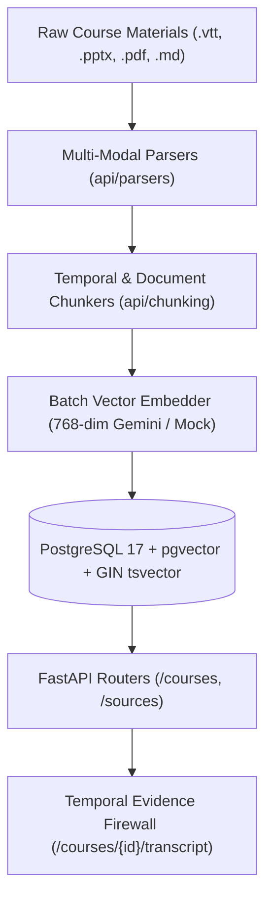

# PRISM Phase 2: Data Model & Ingestion Pipeline

**Team The Falcons:** Fuzail Ahmad & Lakshya Garg  
**Platform Version:** PRISM v0.2.0 (Phase 2 Milestone)  
**Database:** Supabase PostgreSQL 17.11 with `pgvector 0.8.2` and GIN full-text search indexing.  

---

## 1. Architecture Overview

Phase 2 establishes the end-to-end multi-modal data plane for PRISM. It powers the **Temporal Evidence Firewall** and **Evidence Inspector** by parsing, chunking, embedding (768-dimensional vectors), and indexing course materials across four media formats:
- **Video / Audio:** Spoken lecture tracks (`.vtt`, `.srt`, `.mp4`)
- **Presentations:** PowerPoint lecture decks (`.pptx`, `.ppt`)
- **Readings:** Textbook chapters and research papers (`.pdf`)
- **Instructor Notes:** Structured summaries and algorithm cheat sheets (`.md`, `.txt`)



---

## 2. Relational Schema & pgvector Indexing

All domain models are defined in `api/models/` and managed through Alembic migrations (`api/alembic/`):

| Model | Table | Primary Key | Key Columns & Indices |
| :--- | :--- | :--- | :--- |
| `Course` | `courses` | `id (VARCHAR(36))` | `title`, `code` (unique), `instructor`, `term` |
| `Source` | `sources` | `id (VARCHAR(36))` | `course_id`, `type` (`video|pdf|ppt|notes`), `title`, `version`, `status` (`pending|processing|ready|failed`), `duration_sec`, `page_count` |
| `Chunk` | `chunks` | `id (VARCHAR(36))` | `source_id`, `text`, `start_sec`, `end_sec`, `page`, `slide`, `embedding vector(768)`, `tsv tsvector` (GIN Index: `ix_chunks_tsv_gin`) |
| `User` | `users` | `id (VARCHAR(36))` | `email` (unique), `name`, `role` (`student|instructor|admin`) |
| `Session` | `sessions` | `id (VARCHAR(36))` | `course_id`, `user_id`, `current_timestamp_sec`, `playback_speed` |
| `Message` | `messages` | `id (VARCHAR(36))` | `session_id`, `role` (`user|assistant|system`), `content`, `timestamp_sec`, `cited_chunk_ids` |
| `Attempt` | `attempts` | `id (VARCHAR(36))` | `user_id`, `course_id`, `concept_tag`, `score`, `misconception_tag` |
| `MasteryRecord`| `mastery_records` | `id (VARCHAR(36))` | `user_id`, `course_id`, `concept_tag`, `mastery_level`, `confidence` |
| `InterviewSession`| `interview_sessions`| `id (VARCHAR(36))` | `course_id`, `user_id`, `status`, `current_question_index`, `rubric_scores` |

---

## 3. Provider Adapters (`api/providers`)

PRISM implements a uniform `LLMProvider` contract (`embed()`, `generate()`, `stream()`):
- **`GeminiProvider` (Production):** Generates 768-dimensional dense vector embeddings via `gemini-embedding-001` with `outputDimensionality=768` and handles Socratic streaming dialogue via `gemini-1.5-flash`.
- **`MockProvider` (Offline / CI):** Deterministic, zero-latency provider returning cached responses and 768-dimensional reproducible unit-normalized vectors.
- **`BedrockProvider` (Enterprise Stub):** Outlines Amazon Bedrock Runtime integration for Amazon Titan Text Embeddings v2 (`amazon.titan-embed-text-v2:0`) and Anthropic Claude 3.5 Sonnet (`anthropic.claude-3-5-sonnet-20240620-v1:0`) with clear implementation tasks.

---

## 4. Multi-Modal Parsers & Chunkers

### Parsers (`api/parsers/`)
- **`TranscriptParser`:** Parses WebVTT (`.vtt`) and SubRip (`.srt`) files, extracting voice tags (`<v Dr. Elena>`), cleaning HTML tags, and converting cues into exact floating-point timestamps (`start_sec`, `end_sec`).
- **`PDFParser`:** Uses `pypdf` to extract text while maintaining 1-based `page` numbers and total page counts.
- **`PresentationParser`:** Uses `python-pptx` to iterate slide shapes, tables, and speaker notes (`slide.notes_slide.notes_text_frame.text`), preserving 1-based `slide` numbers.
- **`NotesParser`:** Parses Markdown headings (`#`, `##`, `###`) and paragraphs, preserving section hierarchy in metadata.

### Chunkers (`api/chunking/`)
- **`TranscriptChunker`:** Uses a sliding sentence window (default 3 sentences with 1 sentence overlap) to build temporal retrieval windows. Crucially, each chunk retains the exact `start_sec` of its opening cue and the `end_sec` of its closing cue.
- **`DocumentChunker`:** Chunks PDFs by page (splitting oversized pages while preserving `page` number) and PPTX by slide (attaching speaker notes).

---

## 5. REST Endpoints Reference

The FastAPI backend exposes the following course and source endpoints:

| Method | Endpoint | Description |
| :--- | :--- | :--- |
| `POST` | `/courses` | Register a new course (201 Created) |
| `GET` | `/courses` | List all courses with multi-modal source counts |
| `GET` | `/courses/{id}` | Retrieve course details and metadata |
| `POST` | `/courses/{id}/sources` | Upload and ingest a file with `BackgroundTasks` (202 Accepted) |
| `GET` | `/courses/{id}/transcript` | Get lecture transcript with optional `?max_time_sec=` firewall boundary filtering |
| `GET` | `/courses/{id}/resources` | Aggregate all sources grouped by modality (`video`, `pdf`, `ppt`, `notes`) |
| `GET` | `/sources/{id}/status` | Poll asynchronous ingestion status (`pending`, `processing`, `ready`, `failed`) |
| `GET` | `/sources/{id}/file` | Stream raw original source file (`video/mp4`, `text/vtt`, `application/pdf`, etc.) |

---

## 6. Exact Migration & Ingestion Commands

### Step 1: Run Alembic Database Migrations
To apply the database schema, enable `pgvector`, and create all tables and indexes in Supabase:
```bash
# From project root
cd api
python -m alembic upgrade head
```

### Step 2: Seed Demo Data & Generate Vector Embeddings
To seed the 28-minute Binary Search Trees lecture transcript, slides, PDF reading, and markdown notes into Supabase:
```bash
# From project root
python scripts/seed_demo.py
```

### Step 3: Run the Test Suites
To run all unit and integration tests covering parsers, chunkers, and endpoints:
```bash
# Run all tests
python -m pytest api/tests/ -v

# Run specific test suites
python -m pytest api/tests/test_parsers.py -v
python -m pytest api/tests/test_chunker.py -v
python -m pytest api/tests/test_endpoints.py -v
```

### Step 4: Run the Backend Server
```bash
python -m uvicorn api.main:app --host 0.0.0.0 --port 8000 --reload
```
API Documentation will be accessible at:
- **Swagger UI:** `http://localhost:8000/docs`
- **ReDoc:** `http://localhost:8000/redoc`
