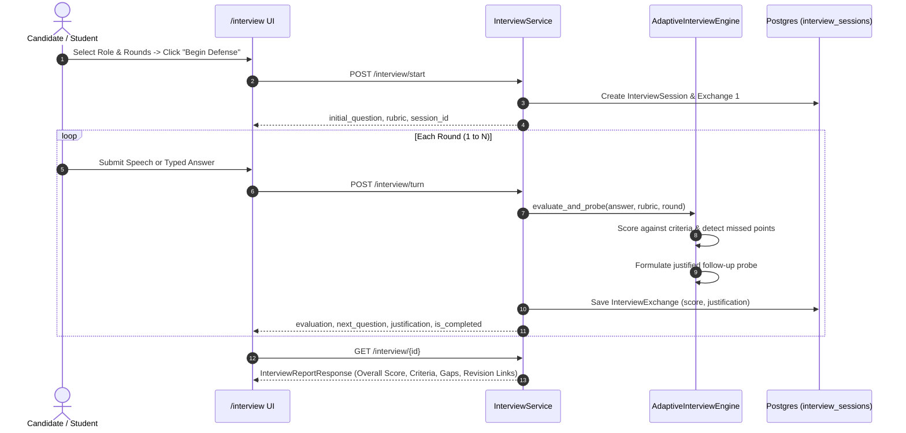

# PRISM Phase 7: Adaptive Oral Defense & Educator Analytics

This document details the architectural specification and implementation of the **Adaptive Technical Interview Engine** and **Educator Confusion Analytics Platform** developed for **PRISM** by **Team The Falcons** (*Fuzail Ahmad & Lakshya Garg*).

---

## 1. Architectural Overview & System Invariants

Phase 7 introduces two interconnected pillars that complete PRISM's assessment lifecycle:
1. **Adaptive Technical Interview (Oral Defense):** An evidence-grounded technical interview where an AI examiner conducts an oral defense on technical topics. The examiner evaluates student explanations against a dynamically synthesized rubric, probing conceptual gaps with justified follow-up questions.
2. **Educator Cohort Insights & Friction Heatmap:** Aggregated telemetry surfacing moments in the lecture where learners experience the highest friction, identifying recurring misconceptions, and mapping student questions to exact video timestamps.

```
┌────────────────────────────────────────────────────────────────────────┐
│                        COURSE EVIDENCE BASE                           │
│     (Lecture Video Cues, Slides, Transcripts, Textbook Notes)         │
└──────────────────────────────────┬─────────────────────────────────────┘
                                   │
                 ┌─────────────────┴─────────────────┐
                 ▼                                   ▼
┌─────────────────────────────────┐ ┌──────────────────────────────────┐
│      RUBRIC GENERATOR           │ │     COHORT ANALYTICS SERVICE     │
│ - Derives role-specific rubric  │ │ - Video timeline friction buckets│
│ - Expected checkpoints          │ │ - Misconception density          │
│ - Grounded evidence citations   │ │ - Question frequency & export    │
└────────────────┬────────────────┘ └────────────────┬─────────────────┘
                 │                                   │
                 ▼                                   ▼
┌─────────────────────────────────┐ ┌──────────────────────────────────┐
│    ADAPTIVE INTERVIEW ENGINE    │ │        EDUCATOR DASHBOARD        │
│ - Socratic response evaluation  │ │ - Interactive timeline heatmap   │
│ - Justified probing logic       │ │ - Top misconceptions card        │
│ - Multi-round oral defense      │ │ - Most frequent inquiries        │
│ - Comprehensive audit report    │ │ - Cohort mastery distributions   │
└─────────────────────────────────┘ └──────────────────────────────────┘
```

### Non-Negotiable Invariants
- **Justified Probing:** Every adaptive follow-up question must persist a clear pedagogical `justification` explaining why the probe was triggered (e.g., *"Follow-up triggered because candidate missed the recursive ancestral property"*).
- **Evidence-Grounded Defense:** Rubric criteria and expected answers are synthesized directly from course materials, not generic web training data.
- **Timestamped Remediation:** All detected defense gaps produce actionable deep-links targeting the exact lecture second (`/learn/[courseId]?t=seconds`).
- **No Autonomous Client Decisions:** All scoring, thresholding, and telemetry aggregations execute server-side within the Python backend.

---

## 2. Technical Roles & Rubric Synthesis

### 2.1 Role Personas
PRISM provides pre-configured role personas tailored to the lecture content:
- **Systems Software Engineer:** Evaluates pointer mechanics, trailing parent pointers in `Tree-Insert`, in-order successor splicing, and memory bounds.
- **Algorithm Specialist:** Evaluates invariant proofs, worst-case degeneration to linked lists ($O(N)$), tree height bounding, and rotation invariance.
- **Backend Platform Engineer:** Evaluates practical BST applications in storage engines, range scans, and index traversal efficiency.

### 2.2 Rubric Structure
The `RubricGenerator` (`api/interview/rubric.py`) produces structured checkpoints:
- **`id` & `name`**: Identifier and criterion title.
- **`weight`**: Relative importance multiplier.
- **`expected_points`**: Key checkpoints required for full credit.
- **`linked_evidence`**: Course citations (`CitationItem`) providing reference truth.
- **`score` & `justification`**: Evaluated during candidate responses.

---

## 3. Adaptive Probing Engine & Turn Lifecycle



### Justification Logic
When a learner answers, `AdaptiveInterviewEngine`:
1. Scans the candidate's explanation against the criterion's `expected_points`.
2. Computes the demonstrated score (0-100%).
3. If critical points were omitted, it formulates a follow-up question with an explicit `justification`:
   ```json
   {
     "criterion_id": "crit-01",
     "score": 60.0,
     "justification": "Candidate verified immediate children but omitted recursive ancestral property across all descendants.",
     "missed_points": ["Recursive ancestral property across all descendants"],
     "follow_up_justification": "Probing ancestral subtree invariant depth because previous answer missed global subtree constraints."
   }
   ```

---

## 4. Defense Audit Report Specification

At the end of the oral defense, PRISM persists and generates a defense report (`/interview/report/[id]`):
- **Cumulative Score Ring:** Visual SVG ring with prism gradient and benchmark passing threshold ($70\%$).
- **Demonstrated Proficiencies:** Bulleted summary of validated technical insights.
- **Identified Conceptual Gaps:** Specific omissions and misconceptions detected during defense.
- **Targeted Lecture Revision Links:** Interactive links targeting exact lecture seconds.
- **Complete Defense Transcript:** Full round-by-round conversation log with "Why this question?" inspection panels.

---

## 5. Educator Analytics & Video Confusion Heatmap

### 5.1 Temporal Timeline Bucketing
`EducatorAnalyticsService` (`api/educator/service.py`) segments the lecture video into 2-minute discrete intervals ($0:00-2:00$, $2:00-4:00$, ..., $28:00-30:00$):
- **Query Count ($Q$):** Number of student questions asked within the interval.
- **Misconception Count ($M$):** Practice or interview errors mapped to that segment.
- **Confusion Intensity ($I$):**
  $$I = \min\left(1.0, \frac{Q + 2.0 \times M}{10.0}\right)$$

### 5.2 Top Misconceptions & Inquiries
- **Misconceptions Card:** Highlights prevalent errors (e.g. `immediate_children_only`, `worst_case_is_always_logn`), occurrences, percentage prevalence, and educator remediation tips.
- **Top Questions Card:** Catalogs exact learner queries, frequency, and video playback coordinates with deep-links.

### 5.3 CSV Export
The endpoint `GET /educator/export/csv` generates a downloadable CSV export containing:
1. `Summary`: Overall active learners, inquiries, practice attempts, and average mastery.
2. `Timeline Confusion Heatmap`: Slices, coordinates, query counts, and confusion intensity.
3. `Top Misconceptions`: Misconception codes, concepts, prevalence, and remediation instructions.
4. `Top Questions`: Inquiries, coordinates, and occurrences.

---

## 6. Endpoints Summary

| Method | Endpoint | Description |
| :--- | :--- | :--- |
| `POST` | `/interview/start` | Initialize interview session, formulate rubric, return initial question |
| `POST` | `/interview/turn` | Evaluate candidate response, return score, justified follow-up probe |
| `GET` | `/interview/{id}` | Retrieve comprehensive defense audit report and revision links |
| `GET` | `/educator/insights` | Retrieve educator analytics, friction heatmap, and cohort distribution |
| `GET` | `/educator/heatmap` | Retrieve high-resolution timeline confusion buckets |
| `GET` | `/educator/export/csv` | Download cohort analytics as an exportable CSV |

---

*Team The Falcons (Fuzail Ahmad & Lakshya Garg) — PRISM Evidence Engine*
